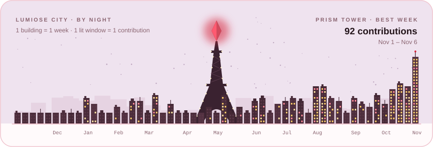
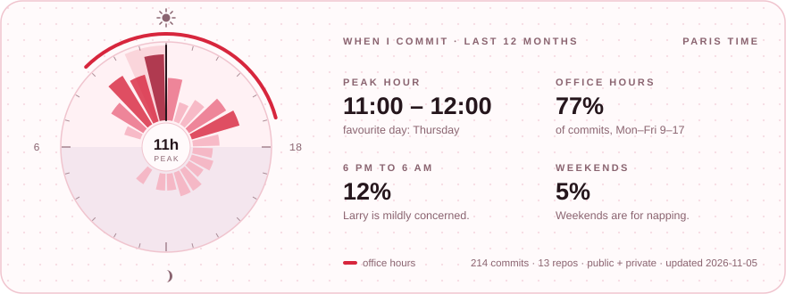
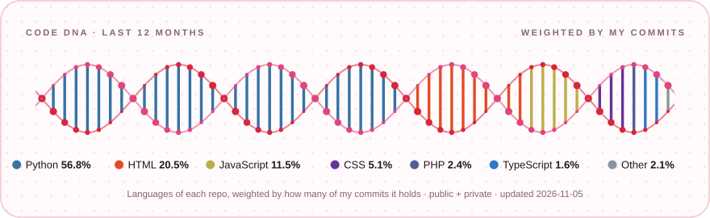
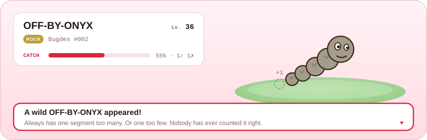

<picture><source media="(prefers-color-scheme: dark)" srcset="assets/dark/card.svg"></picture>

<!-- status:start -->

<b>Asleep.</b> Even Dunsparce needs eight hours. · <i>live status, Paris time</i>

<!-- status:end -->

## 👋 Hi, I'm shalee-pnt

Third-year **BUT Computer Science** student on the application development track, in a work-study program at a **city hall on the French Riviera**. I build tools for the staff there: a search engine for the shared drive, an audit that grades folder organisation out of 100, and scripts that keep an eye on mailbox sizes.

My specialty is the **Normal type**. Like Larry, my favourite Elite Four member, I like reliable, unflashy things that just work, and clocking out on time.

**Career goal:** a permanent contract, then fifty years of doing nothing.

## 🏙️ Activity

<picture><source media="(prefers-color-scheme: dark)" srcset="assets/dark/skyline.svg"></picture>

<picture><source media="(prefers-color-scheme: dark)" srcset="assets/dark/clock.svg"></picture>

## ⚔️ Party

<picture><source media="(prefers-color-scheme: dark)" srcset="assets/dark/party.svg"></picture>

<b>Full PC box</b> (everything else I've trained)

 

**Languages** · Python · JavaScript · TypeScript · HTML/CSS · SQL · Java · C · C++ · PHP 
**Frameworks** · Flask · Node.js · Express · React · React Native · Expo · Next.js · Vue / Nuxt · Laravel 
**Data** · MariaDB / MySQL · SQLite · MongoDB · Whoosh · XML / JSON / CSV 
**Hardware & infra** · ESP32 · Arduino · NFC · MQTT · Docker · Linux · Active Directory / LDAP 
**Also** · Three.js · Canvas API · Ollama · Ren'Py · ReportLab · python-docx · PyPDF2

## 📈 Base stats

<picture><source media="(prefers-color-scheme: dark)" srcset="assets/dark/stats.svg"></picture>

<picture><source media="(prefers-color-scheme: dark)" srcset="assets/dark/battle.svg"></picture>

## ⌚ Projects

<picture><source media="(prefers-color-scheme: dark)" srcset="assets/dark/projects.svg"></picture>

| | Project | What it does | Stack |
|:-:|:--|:--|:--|
| 01 | **Metacatalogue** 🔒 | Catalogue and audit app for a whole file server: full-text search, AD sign-in, AI summaries from a local LLM | Python · Flask · MariaDB · Whoosh · Ollama |
| 02 | **[ViscoCrowd](https://github.com/ViscoCrowd/ViscoCrowd-simulation)** | Panic evacuation of an indoor pool as a particle simulation. I built the wet-floor physics (grip-bounded acceleration), the exit flow measurements, the pool parameter sweeps against a dry control, and the Windows tooling | Python · NumPy · SciPy · Matplotlib · Docker |
| 03 | **[Scubanion](https://github.com/Scubatana/scubanion)** | Connected Tamagotchi that grows when you walk. I wrote the NFC kiosk firmware and its anti-cheat | C++ · ESP32 · MQTT · Laravel · Nuxt |
| 04 | **AllRoads** 🔒 | Urban mobility app for the Nice area. I designed tables and stored procedures, and redesigned sign-up | TypeScript · Node.js · MySQL |
| 05 | **Langdle** 🔒 | Guess the programming language of the day | JavaScript · Node.js |
| 06 | **PastaBox Randomizer** 🔒 | Picks your PastaBox of the day and runs the cooking timer | JavaScript |

🔒 private repo (work, school or not ready yet). Also on the bench: a document audit tool (grades folder organisation out of 100, work), Cartoondle (guess the cartoon of the day, in progress), Tied to You (Ren'Py visual novel), <a href="https://shalee-pnt.github.io/bancs-qui-parlent/">Les bancs qui parlent</a> (public benches that whisper local stories).

## 🧬 Code DNA

<picture><source media="(prefers-color-scheme: dark)" srcset="assets/dark/dna.svg"></picture>

## 🌿 A wild bug appeared!

<picture><source media="(prefers-color-scheme: dark)" srcset="assets/dark/encounter.svg"></picture>

<!-- encounter:start -->

<a href="https://github.com/shalee-pnt/shalee-pnt/issues/new?title=catch%3A%20throw%20a%20Pok%C3%A9%20Ball&body=Just%20press%20%2A%2ACreate%2A%2A%20%28or%20%2A%2ASubmit%20new%20issue%2A%2A%29.%0A%0AA%20GitHub%20Action%20throws%20the%20ball%20at%20today%27s%20wild%20bug%20and%20replies%20here%20within%20a%20minute%20or%20two.%20One%20throw%20per%20trainer%20per%20day."><picture><source media="(prefers-color-scheme: dark)" srcset="assets/dark/button.svg"></picture></a>

<b>Bugdex</b> 2/8 species caught by visitors · 5 throws · 2 trainers · a new bug appears every day at midnight (Paris)

| Trainer | Bug | Result | Date |
|:--|:--|:--|:--|
| [@CodeByHaamza](https://github.com/CodeByHaamza) | Heisenbuzz | caught | 2026-11-09 |
| [@shalee-pnt](https://github.com/shalee-pnt) | Heisenbuzz | broke free | 2026-11-09 |
| [@shalee-pnt](https://github.com/shalee-pnt) | Off-by-Onyx | caught | 2026-11-08 |
| [@shalee-pnt](https://github.com/shalee-pnt) | Off-by-Onyx | broke free | 2026-11-07 |
| [@shalee-pnt](https://github.com/shalee-pnt) | Conflictwin | broke free | 2026-11-05 |
<!-- encounter:end -->

---

Favourite Pokémon: <b>Dunsparce</b> (Insolourdo), a tsuchinoko with a drill for a tail. Objectively great design. 
Party levels, code DNA, base stats, battle log, commit clock and wild bugs refresh daily via GitHub Actions; Dunsparce gets hungry and the sky over Lumiose follows the real sun and moon over Paris, every hour. All SVG, generated by <a href="scripts/profile.py">one Python script</a>. 
Fan-made and unaffiliated. Pokémon, Dunsparce and Dudunsparce artwork and 3D render © Nintendo / Creatures / GAME FREAK. Ben 10 © Cartoon Network. Logos from <a href="https://devicon.dev">Devicon</a> (MIT).

